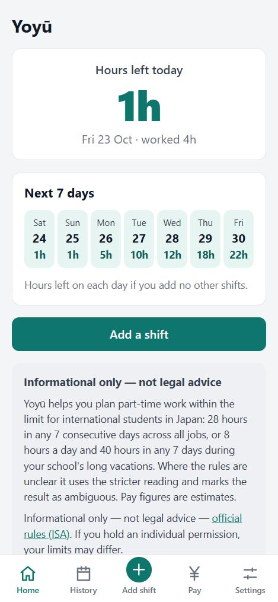
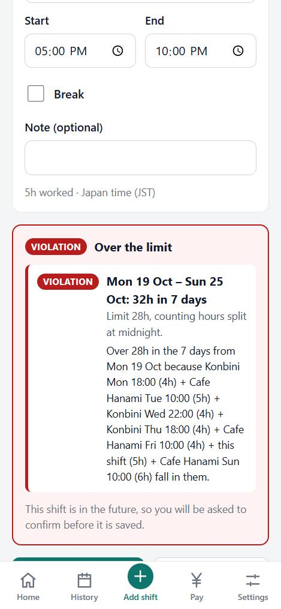
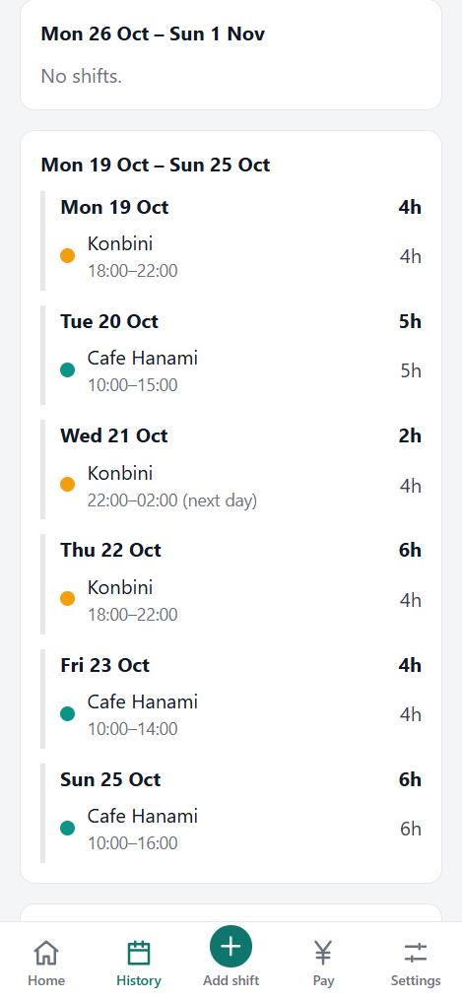
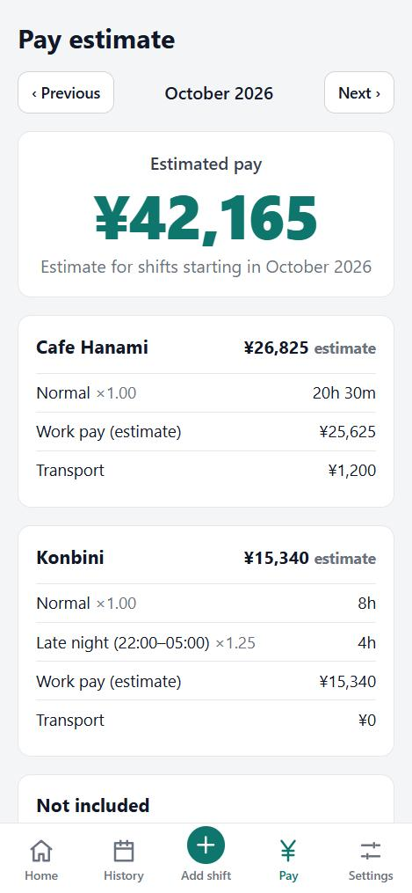
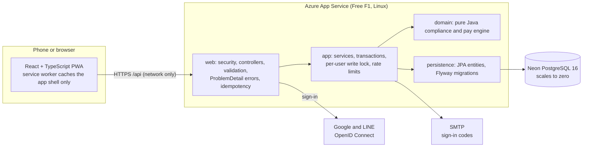

# Yoyū (余裕)

**A work-hour tracker for international students in Japan.** Students with permission for part-time work may work at most **28 hours in any 7 consecutive days, across all jobs combined**. Employer tools such as WILL GROUP's アワマネ (Hourmane) only see the hours worked for that employer, so nobody but the student can see whether they are about to go over. Yoyū is the student-side tool: log shifts from every job, see the hours left on each day, get warned *before* accepting a shift that breaks the limit, and estimate pay.

**Live app: [yoyu.azurewebsites.net](https://yoyu.azurewebsites.net)** · installable as a phone app (PWA) · [Privacy Policy](https://yoyu.azurewebsites.net/privacy) · [Terms](https://yoyu.azurewebsites.net/terms)

> It runs on free hosting: after about 20 idle minutes the first request takes around 45 seconds while the server starts.

| Hours left | Warning before saving | History | Pay estimate |
| --- | --- | --- | --- |
|  |  |  |  |

*Screenshots use made-up demo data.*

> Yoyū is the product name; the code name is Shift28 (Java package, database and Maven artifact).

## What it does

- **Every job in one place.** Log shifts from all your jobs, including overnight shifts and breaks.
- **Hours left.** See how many hours you can still work today and on each of the next 7 days, across every job.
- **Warned before, never blocked after.** The form checks a shift while you type. A future shift that would break a limit needs confirmation; a shift that already happened is always saved, with the problem shown. Every warning names the shifts that cause it.
- **Long vacations.** Mark your school's vacations and the 8 hours a day / 40 hours in 7 days limits apply; weeks that mix both are flagged as ambiguous.
- **Pay estimate.** A monthly estimate per job with late-night and overtime premiums and transport.
- **Sign in your way.** Google, LINE, or email and password with emailed codes. Settings links and unlinks providers, changes the email or password, and deletes the account with all its data.

## Architecture



One Spring Boot jar serves both the API and the built frontend, so the whole app ships as one container or one jar. The **domain engine has no Spring or JPA imports**: shifts, vacations, rule versions and the clock go in, results come out, so every rule is tested without a database.

### Tech stack

| Layer | Technology |
| --- | --- |
| Backend | Java 21, Spring Boot 4, Spring Web, Spring Data JPA, Spring Security (OAuth2 client), Spring Session JDBC, Bean Validation |
| Database | PostgreSQL 16, Flyway migrations (9), `btree_gist` exclusion constraint |
| Frontend | React 19, TypeScript, Vite, vite-plugin-pwa (service worker, manifest, installable) |
| Tests | JUnit 5, AssertJ, Testcontainers (PostgreSQL), MockMvc, Vitest |
| Build and run | Maven wrapper, Docker (multi-stage), Docker Compose, GitHub Actions |

## Compliance rules

| Rule | Value | Source |
| --- | --- | --- |
| Any 7 consecutive days, all jobs combined | 28 hours | [Immigration Services Agency](https://www.moj.go.jp/isa/applications/procedures/nyuukokukanri07_00003.html) ("1週について28時間以内"); any-7-days reading: [Shiodome Partners](https://shiodome.co.jp/column/7855/), [freee support](https://support.freee.co.jp/hc/ja/articles/59085137401881) |
| During the school's long vacations, per day | 8 hours | [Immigration Services Agency](https://www.moj.go.jp/isa/applications/procedures/nyuukokukanri07_00003.html) |
| During long vacations, any 7 days | 40 hours | Labour Standards Act 40-hour week ([Townwork](https://townwork.net/magazine/?p=73524)); not on the ISA page, kept as a stricter cap |
| A 7-day window that mixes vacation and regular days | Flagged as ambiguous between 28 h and 40 h | The rules don't say which applies ([jinjibu Q&A](https://jinjibu.jp/qa/detl/70284/1/)) |
| Pay estimate | Late-night 25%, overtime 25%, both 50% | [Money Forward](https://biz.moneyforward.com/payroll/basic/82774/) |

The full rules and 36 test cases (T1–T30 and E1–E6) are in [docs/SPEC.md](docs/SPEC.md), and the domain tests implement them one to one.

### Rolling seven-day windows

The limit is checked over **every** 7-date window, not calendar weeks. Calendar weeks miss violations: four 7-hour shifts from Friday to Monday plus one hour on Tuesday look fine in their own Monday–Sunday weeks (21 h and 8 h), yet the 7 days starting Friday add up to 29 h (test T3). For each shift the engine evaluates every window that contains a date the shift touches, and "hours left" on a day is the tightest remaining room across the 7 windows that contain it, always using the strict 28-hour limit so following the app never produces an ambiguous result.

### Overnight shifts

The rules don't say whether a shift that crosses midnight belongs to the day it starts or is split by calendar day, so Yoyū evaluates **both** and reports the worse result, saying which reading produced it. A 22:00–03:00 shift counts 2 h and 3 h on the two dates under one reading and 5 h on the start date under the other (T5, T7). All day logic is anchored to one constant zone, `Asia/Tokyo`, so a shift entered with another offset gives identical results regardless of the server's or phone's time zone (T15).

### Rule versions

Limits live in a `rule_versions` table with effective dates, so a future rule change is a new migration. A window that spans a change uses the strictest value in effect on any of its dates, and results for earlier dates are never rewritten.

## PostgreSQL data integrity and concurrency

- **The database enforces invariants, not just the code.** A GiST **exclusion constraint** rejects overlapping shifts for a user across all jobs; `CHECK` constraints bound shift length and breaks; a composite foreign key makes it impossible to attach a shift to another user's job.
- **No lost checks.** Shift and vacation writes first lock the user's row with `SELECT … FOR NO KEY UPDATE`, so a compliance check and the save it guards never race with another write by the same user. `FOR NO KEY UPDATE` rather than `FOR UPDATE` avoids a deadlock with idempotency-key inserts; a test shows the difference.
- **Optimistic locking.** Jobs, shifts and vacations carry a version; a stale edit is a `409` with `"stale": true` instead of a silent overwrite.
- **Safe retries.** `POST` creates accept an `Idempotency-Key`: the key row is claimed in the same transaction as the write, concurrent duplicates wait and replay, and reusing a key for a different request is `422`.
- **Integer minutes and yen.** No floating point for time or money; premiums use `BigDecimal` and round once per shift.
- **Instants, not local times.** Stored as `timestamptz`; the JVM default zone is pinned to UTC.

## Authentication architecture

- **Server-side sessions** in PostgreSQL (Spring Session JDBC) behind an `HttpOnly`, `Secure`, `SameSite=Lax` cookie; CSRF tokens on every state-changing request, including sign-in and sign-out.
- **Google and LINE via OpenID Connect** with PKCE, state and nonce. Provider access tokens are never stored, and accounts are never merged by email: a Google identity whose verified email already has an account must sign in and link it.
- **Email one-time codes** for sign-up, password reset and email change, stored as an HMAC (not a plain hash of six digits), single use, expiring, with an attempt limit. Sign-up, reset and email change respond identically whether or not an address has an account.
- **Passwords:** BCrypt, length rules, and a check against a bundled list of about 9,100 common passwords.
- **Recent-proof gate** (password, emailed code, or a fresh provider sign-in) before deleting the account, changing the email or password, or linking or unlinking a provider. Credential changes bump a session version checked on every request, which ends other sessions.
- **User isolation:** every query is scoped to the signed-in user, and another user's resource answers `404`.
- Design decisions and the mistakes that shaped them are written down in [docs/DECISIONS.md](docs/DECISIONS.md) and [mistakes.md](mistakes.md).

## Security measures

- Per-account and per-IP **rate limits** with account-wide ceilings, counted *before* the slow check so parallel guesses can't slip past, and a global cap on new OAuth sign-in sessions.
- **Anonymous data is bounded:** sessions without an account, unfinished sign-ups and password-reset codes have hard lifetimes and are cleaned up at startup and by a sweep that runs only while something is pending, so these sweeps never wake the database of an idle free-tier server and attacker traffic can't fill it.
- **Proxy hardening:** behind a reverse proxy the client IP comes only from a configured header, and a fixed public origin replaces forwarded host and scheme headers. Both rules came from probing a real platform with forged headers.
- Headers: HSTS, Content-Security-Policy, `X-Frame-Options: DENY`, same-origin referrer policy, restrictive permissions policy. The service worker never caches `/api`.
- RFC 9457 `ProblemDetail` errors; unexpected errors are logged server-side only. Application code does not log passwords, one-time codes, tokens or client IP addresses.
- No analytics, ads, tracking scripts or third-party fonts. The [Privacy Policy](https://yoyu.azurewebsites.net/privacy) states only what the code does. No residence-card or visa data is ever stored.

See [SECURITY.md](SECURITY.md) to report a vulnerability.

## REST API overview

Everything is under `/api`, JSON, session cookie plus CSRF token.

| Area | Endpoints |
| --- | --- |
| Auth | `POST /auth/register`, `/auth/register/verify`, `/auth/login`, `/auth/login/verify`, `/auth/logout`; `POST /auth/password/forgot`, `/auth/password/reset`; `POST /auth/reauthenticate`; `GET /auth/me`, `/auth/providers` |
| Social sign-in | `/oauth2/authorization/{google,line}` (start), `GET /auth/social/pending`, `POST /auth/social/complete` |
| Account | `PUT /account/profile`, `PUT /account/password`, `POST /account/email`, link and unlink providers, `DELETE /account` |
| Jobs | `GET`/`POST /jobs`, `PUT`/`DELETE /jobs/{id}`, `POST /jobs/{id}/restore` |
| Shifts | `GET /shifts?from=&to=`, `POST /shifts`, `PUT`/`DELETE /shifts/{id}` |
| Vacations | `GET`/`POST /vacations`, `PUT`/`DELETE /vacations/{id}` |
| Compliance and pay | `GET /compliance?from=&to=`, `POST /compliance/check` (draft shift), `GET /pay?from=&to=` |
| Health | `GET /health` (no database or session access) |

The full contract, including response shapes, is in [docs/SPEC.md](docs/SPEC.md) section 4.

## Quick start

Requires only **Docker**.

```bash
docker compose up --build
```

Open http://localhost:8028 and create an account with any email address. The sign-up code is delivered to a local **Mailpit** inbox at http://localhost:8025, so no real email is sent. Google and LINE buttons stay hidden until you configure them (see below).

Stop with `docker compose down` (add `-v` to delete the local database volume). The database and the app are published on `127.0.0.1` only. Use `DB_PORT`, `APP_PORT`, `MAILPIT_UI_PORT` and `MAILPIT_SMTP_PORT` (see `.env.example`) if a port is taken.

### Development without rebuilding the image

Requires JDK 21, Node.js 24 and Docker. In three terminals from the repository root:

```bash
docker compose up -d db
```

```bash
cd backend && ./mvnw spring-boot:run
```

```bash
cd frontend && npm install && npm run dev
```

The Vite dev server runs on http://localhost:5728 and proxies `/api` and the OAuth paths to the backend on 8028. `cd backend && ./mvnw spring-boot:test-run` starts the backend on a throwaway Testcontainers database instead. On Linux or macOS, run `chmod +x backend/mvnw` once if your checkout lost the executable bit.

## Configuration

Every secret comes from environment variables; nothing is committed. Copy `.env.example` to `.env` for local overrides. A sign-in method stays hidden until it is configured.

| Variable | Purpose |
| --- | --- |
| `DB_URL`, `DB_USERNAME`, `DB_PASSWORD` | Database. Defaults match `docker-compose.yml` for local development. Use `sslmode=verify-full` against a managed database. |
| `MAIL_ENABLED`, `MAIL_HOST`, `MAIL_PORT`, `MAIL_USERNAME`, `MAIL_PASSWORD`, `MAIL_FROM`, `MAIL_STARTTLS` | SMTP. `MAIL_ENABLED=true` turns on email sign-up, codes, password reset and email change. |
| `OTP_SECRET` | At least 32 random bytes (`openssl rand -base64 48`); required when mail is enabled. The Compose file sets a local-only placeholder. |
| `GOOGLE_CLIENT_ID`, `GOOGLE_CLIENT_SECRET` | Google OAuth web client. |
| `LINE_CHANNEL_ID`, `LINE_CHANNEL_SECRET`, `LINE_EMAIL_SCOPE` | LINE Login channel; `LINE_EMAIL_SCOPE=true` only after LINE approves the email permission. |
| `SESSION_COOKIE_SECURE` | `true` in production (always on when `PUBLIC_ORIGIN` is set). |
| `PUBLIC_ORIGIN` | The app's public HTTPS origin in production: requests are handled as this origin, forwarded headers are ignored, and OAuth callbacks use it. Empty locally. |
| `CLIENT_IP_HEADER` | Header a trusted proxy appends the real client IP to (for example `X-Client-IP` on Azure App Service). Empty elsewhere. |
| `PORT` | Server port (default 8028). |

- **Google:** create a project in Google Cloud Console, configure the OAuth consent screen (External; scopes `openid`, `email`, `profile`), and create a *Web application* client with redirect URI `http://localhost:8028/login/oauth2/code/google` (add your production URL too). Add test users while the app is in testing mode. Publishing with only these scopes needs no verification. Without a published, verified app Google sends no sign-in time, so Google-only accounts confirm "it's you" with an emailed code.
- **LINE:** create a *LINE Login* channel (Web app) and add the callback `http://localhost:8028/login/oauth2/code/line`. Switch the channel from *Developing* to *Published* for real users.
- **Real email locally:** copy `.env.smtp.example` to `.env.smtp`, fill it in, then run `docker compose -f docker-compose.yml -f docker-compose.smtp.yml up -d --build app`.

## Testing

| Suite | Tests | Command |
| --- | --- | --- |
| Domain engine (pure Java; spec cases T1–T30, E1–E6) | 74 | `cd backend && ./mvnw test -Dtest='com.shift28.domain.**'` |
| Persistence (Testcontainers PostgreSQL 16) | 78 | `cd backend && ./mvnw test -Dtest='com.shift28.persistence.**'` |
| API and security (MockMvc, real database, real OAuth callback with a stubbed token endpoint) | 278 | `cd backend && ./mvnw test -Dtest='com.shift28.web.**'` |
| Rate limiter | 5 | `cd backend && ./mvnw test -Dtest='com.shift28.app.**'` |
| Application context and migrations | 2 | part of `./mvnw test` |
| Frontend logic, screens and legal pages (Vitest) | 167 | `cd frontend && npm test` |

**437 backend and 167 frontend tests.** The backend tests need a running Docker daemon (Testcontainers starts PostgreSQL 16). Notable tests exercise parallel logins against the rate limit, concurrent creates with and without idempotency keys, forged proxy headers, the full Google/LINE callback flow, and cleanup that survives restarts and failed sweeps. Several tests were added after a review found them passing for the wrong reason; those cases are recorded in [mistakes.md](mistakes.md).

## Continuous integration

[`.github/workflows/ci.yml`](.github/workflows/ci.yml) runs on every push and pull request:

- **backend:** `./mvnw verify` (all tests, Testcontainers on the runner's Docker)
- **frontend:** `npm ci`, lint, tests, production build, and a check that the PWA files exist
- **compose:** builds the image, starts the stack, and probes `/api/health` and a client-side route

A fourth job deploys `main` to Azure App Service through OpenID Connect (a short-lived token, no stored password). It runs only when the repository variable `AZURE_WEBAPP_NAME` and the Azure secrets are set, so forks and fresh clones never deploy.

## Engineering metrics

| | |
| --- | --- |
| Backend tests / frontend tests | 437 / 167 |
| Specification test cases implemented | 36 |
| Flyway migrations | 9 |
| Backend source | 109 Java files, about 6,300 lines; the 25-file domain package imports no Spring or JPA |
| Production frontend dependencies with known vulnerabilities (`npm audit --omit=dev`) | 0 |
| Cost to run in production | free tiers only |

## Known limitations

- **Cold starts.** The free hosting plan unloads the app after about 20 idle minutes, so the first request can take around 45 seconds, and it has daily CPU and bandwidth quotas.
- **Single instance.** Rate-limit counters are in memory and reset on restart; scaling out would need a shared store.
- **Google branding.** The Google OAuth app is published but not brand-verified (the host is a shared `azurewebsites.net` address), so Google's consent screen shows the domain instead of the app name.
- **Interpretation of the rules.** Some points are unclear in the official rules (for example overnight shifts and weeks that cross a vacation). Yoyū uses the stricter reading and labels the result as ambiguous; it can still be wrong or out of date.
- **Pay is an estimate.** It does not include legal-holiday premiums, overtime from weekly totals, the extra premium beyond 60 overtime hours a month, overtime from combining hours across employers, taxes or deductions.
- **Online only.** Hours can't be checked offline; the installed app shows a clear offline message and never caches API data.
- **English only,** no notifications, and no phone-number sign-in (LINE phone verification needs corporate approval and SMS costs money).
- **Manual production deploys** (the CI deploy job is optional and off by default).

## Disclaimer

Informational only — not legal advice — [official rules (ISA)](https://www.moj.go.jp/isa/applications/procedures/nyuukokukanri07_00003.html). If you hold an individual permission, your limits may differ. Yoyū is a planning aid, is not affiliated with any government agency, school or employer, and does not guarantee compliance.

## License

[MIT](LICENSE). Third-party components and data are listed in [THIRD_PARTY_NOTICES.md](THIRD_PARTY_NOTICES.md).
